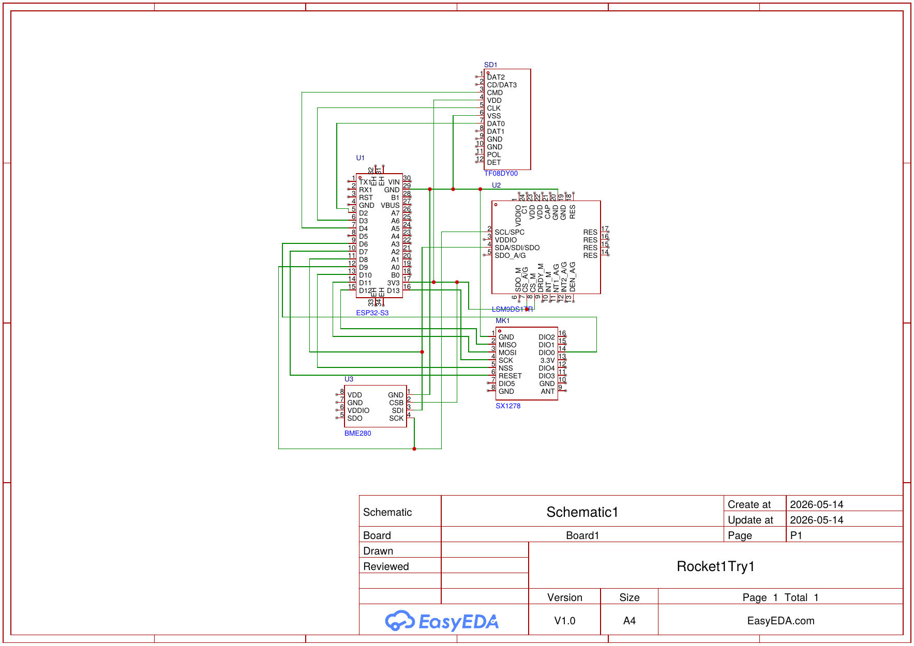

# WSO CanSat rocket

A single-stage model rocket that carries a CanSat-style avionics payload, designed for the
**World Space Olympiad** engineering competition. Our team of four from Galaxy International
School (Almaty, Kazakhstan) reached the **national stage** with this design in 2026.

It is a **design entry**: the rocket was not built, because we did not have the resources to
manufacture and fly it.

## My part

I did all of the mechanical design in Autodesk Fusion and the flight model in OpenRocket, and
drew the flight-computer schematic in EasyEDA. The competition presentation was made by my
teammates and is not included here.

## The rocket

| Section | Design |
|---|---|
| Nose cone | PETG, with an integrated ballast compartment to move the centre of gravity forward |
| Avionics bay | Carbon-fibre-filled PETG. It is stiffer than plain PETG, so the IMU picks up less vibration |
| Body tube | PETG, 2.5 mm wall, for impact resistance on landing |
| Motor compartment | PETG at 100% infill, to carry thrust into the airframe |
| Fins | PETG with 30% gyroid infill: equal strength in all directions while keeping the tail light, so the rocket is not tail-heavy |
| Recovery | Ripstop nylon parachute deployed by the motor's ejection charge, protected from the charge's heat by Kevlar cord and a basalt-fabric gasket |

Print settings used for the design: 0.4 mm nozzle, 0.2 mm layers, 4–5 perimeters on every
load-bearing part.

## Flight computer



| Part | Role |
|---|---|
| ESP32-S3 | Flight computer |
| LSM9DS1 | 9-axis IMU (accelerometer, gyroscope, magnetometer) |
| BME280 | Barometric pressure, for altitude |
| SX1278 | LoRa radio for telemetry to the ground |
| microSD card | On-board flight log |

The schematic connects the modules. Power regulation and decoupling are not drawn yet.

## Files

```
cad/Rocket1.f3d                  Fusion model of the rocket
cad/InternalTubeRocket1.f3z      Fusion archive of the rocket with its internal tube
simulation/Rocket1.ork           OpenRocket flight model (OpenRocket 24.12)
electronics/flight-computer-schematic.pdf   EasyEDA schematic (also as .png)
```

Open the `.f3d` / `.f3z` files in Autodesk Fusion and the `.ork` file in
[OpenRocket](https://openrocket.info/).

## Known issues before a real flight

The OpenRocket model shows two things that would need fixing before this rocket flies:

- **Rail exit speed.** On the 0.7 m launch rod in the model, the rocket leaves the rail well below
  the usual guideline of about 15 m/s, so it would turn into the wind. It needs a longer rail or a
  higher-thrust motor.
- **Descent rate.** The parachute in the model is too small for the rocket's mass, so it would land
  faster than the 4–6 m/s that model rocketry usually aims for. It needs a larger canopy, and the
  ejection delay should be matched to the time to apogee in the simulation.
